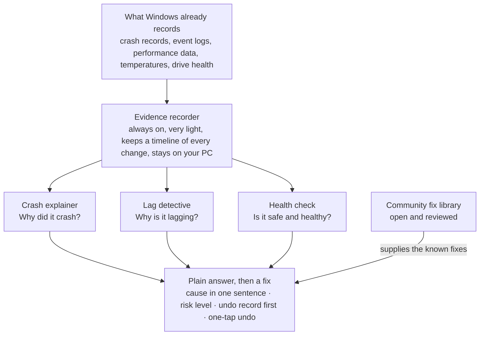

# Sherlog: Windows PC Health, Explained

## The idea

Sherlog is a free, open-source Windows app that answers three questions in plain language: **why did it crash, why is it slow, and is my PC safe and healthy?** Then it fixes the cause, and every fix can be undone in one tap.

It works like an aircraft flight recorder. It quietly records crashes, performance and every change made to the PC, so when something goes wrong the evidence is already there. Most tools only start looking after you open them, and by then the clues are gone.

It has three parts that work together: a **recorder** that gathers evidence, **explainers** that turn it into plain answers, and a **guarded fix system** that both people and AI agents can use safely.

**Why "Sherlog":** Sherlock plus log, a detective that reads your PC's logs and names the culprit. Tagline: *"Elementary: your graphics driver did it."* A quick search found no software using the name, but confirm it on GitHub, domains, the Microsoft Store and in a trademark search before launch.

## The problem

Windows already records most of the answers, but hides them where ordinary people never look. Crash records, Reliability Monitor, performance counters and drive health data all exist. They are just scattered, technical and unexplained.

Today's options fail people in different ways:

- **Cleaner apps** treat symptoms. They delete temp files and "fix" registry entries, often using scare counts like "1,284 problems found" to push upgrades.
- **Expert tools** such as Event Viewer, crash-dump analyzers and Task Manager show raw data but explain nothing.
- **Forums and videos** give generic advice ("reinstall your drivers") that may not match the actual cause.
- **Reinstalling Windows** works, but costs hours and destroys the evidence of what went wrong.

Microsoft's own free PC Manager app shows the gap. Its main features are a one-click boost that clears temporary files and closes background processes, storage cleanup, startup app management, a health check and shortcuts to security settings ([Data Doctors, Jan 2026](https://wtop.com/tech/2026/01/data-doctors-should-i-be-using-microsoft-pc-manager)). It tidies the PC, but it does not explain why a game crashed or why it lags.

## Who it is for

Anyone who uses Windows, with **gamers as the launch audience**. Gamers crash more, search for fixes more, and recommend tools to friends. The same app then works for everyone else without changes.

| Question | When it comes up | What the person wants |
| --- | --- | --- |
| Why did it crash, and what's the fix? | A game or app just closed or froze | The cause in one sentence and a fix that works |
| Why is my PC lagging? | Stutter in a game, slow apps, freezes | Which kind of lag it is and what is causing it |
| Is my Windows safe and healthy? | Anytime, or before trusting the PC with something important | One clear verdict, plus anything that needs attention |

## How it works

One light recorder collects what Windows already logs, and three engines turn it into answers for the three questions.

Every answer ends the same way: the cause in plain words, then a fix from the community library that can be undone.

## The change timeline

The recorder's most powerful job is noting every change: driver updates, Windows updates, new apps, new startup items and changed settings. Most PC problems start right after something changed, so lining up changes against problems usually reveals the cause.

- "Your game started crashing 2 days after the graphics driver update on Nov 3. Roll back to the previous version?"
- "Startup got 40% slower after you installed 3 apps last week. One of them adds 12 seconds."
- "No crashes in the 30 days before this Windows update, and 6 since."

This turns guessing into evidence, and it makes undo precise: Sherlog knows exactly what to reverse.

## 1. Why did my game or app crash?

Sherlog names the file that failed, explains it in plain words, and offers the matching fix, usually within seconds of the crash.

**What it reads:** the crash records Windows already keeps. These include Windows Error Reporting entries, Application Error events in the event log, blue-screen memory dumps, graphics-driver reset events ("display driver stopped responding") and Reliability Monitor history.

**How it explains:** it matches the failing file to a known cause. For example:

| What Windows recorded | What Sherlog says | Typical fix |
| --- | --- | --- |
| `nvlddmkm.sys`, `amdkmdag.sys` | Your graphics driver crashed | Roll back or clean-install the driver |
| An overlay file (Discord, Steam, RivaTuner) | An overlay hooked into the game | Turn that overlay off for this game |
| A game's own file, repeatedly | The game's files may be damaged | Verify the game files in its launcher |
| Random blue screens with different causes | Possibly unstable memory or overclock | Reset overclock or XMP, then test memory |

**How it reaches you:** a notification appears right after the crash, such as "Valorant just crashed. We know why. Fix it?" A history screen shows past crashes grouped by cause, so repeat problems stand out.

**How sure it is:** every diagnosis carries a confidence level: **Confirmed** (clear evidence, known fix), **Likely** (strong pattern, worth trying) or **Unclear** (here is what we know and what to try next). A wrong answer stated confidently does more damage than an honest "not sure yet."

## 2. Why is my PC lagging?

"Lag" covers several different problems, and Sherlog's main job is to say which one you have before suggesting anything.

| Kind of lag | What it feels like | What Sherlog checks |
| --- | --- | --- |
| Frame stutter | Game hitches while the FPS counter looks fine | Frame-time spikes, and what ran at that exact moment |
| Overheating | Smooth at first, slower after 10–20 minutes | CPU and GPU temperatures and clock-speed drops |
| Resource hog | Everything slows at once | Which app or task is using CPU, memory or disk |
| Background Windows work | Random slowdowns, fan spins up | Windows Update, antivirus scans, indexing |
| Driver latency | Audio crackle, mouse micro-freezes | Drivers that hold up the system (DPC latency) |
| Slow or failing drive | Long loading, apps freeze for seconds | Disk response times and drive health |

**"It's slow right now" button:** when you feel lag, press a hotkey. Sherlog records about 30 seconds of activity and explains the cause, such as "A Defender scan of your Downloads folder is using the disk heavily."

**What "normal" means for your PC:** Sherlog learns each PC's own baseline for boot time, game frame rates and temperatures. It can then say "slower than usual for this PC since Tuesday" instead of comparing against generic numbers. For gamers, it can compare a smooth session against a stuttery one and show what was different.

## 3. Is my Windows safe and healthy?

Sherlog gives one plain verdict, such as "Healthy, with 1 thing worth a look," built from three parts. Each part can be opened to see exactly what was checked.

| Part | What it checks |
| --- | --- |
| Security | Microsoft Defender is on and up to date, firewall is on, Windows updates are current, Secure Boot and TPM are on, nothing unknown launches at startup |
| System integrity | Windows' own repair checks (`sfc` and `DISM`) find no damaged system files; no repeated service failures |
| Hardware | Drive wear and remaining life, temperatures at rest and under load, battery capacity on laptops |

Sherlog is **not an antivirus**. It checks that the protection Windows already includes is switched on and working, and points to Defender when a deeper scan is needed.

It also looks ahead, like a car's service reminder: "Your SSD has used 82% of its rated life. Back up and plan a replacement in the next few months."

It also flags when Windows itself is out of support. Windows 10 stopped receiving free security updates in October 2025, so a Windows 10 PC without Extended Security Updates is marked "not safe" with clear upgrade options.

## The fix system

Every fix carries a risk level, explains itself before it runs, and can be undone.

| Level | Examples | How it runs |
| --- | --- | --- |
| Safe | Turn off a game overlay, end a stuck background task | Can run automatically if the user allows it |
| Moderate | Roll back a driver, disable a startup app, repair system files | Asks first and shows what will change |
| Advanced | Reset overclock or memory settings, reinstall a driver cleanly | Asks first, explains the risk, recommends a backup |

Rules that apply to every fix:

1. Say what will change, why, and how long it takes, before running.
2. Save a precise undo record first: the previous driver package, the old setting value, the disabled startup entry. Also create a Windows restore point when System Protection is on, but never rely on it alone. By default, Windows skips a new restore point if one was made in the last 24 hours ([Microsoft Learn](https://learn.microsoft.com/en-us/windows/win32/sr/calling-srsetrestorepoint)), and System Protection is sometimes switched off.
3. Check afterwards whether the problem actually went away, and report it honestly.
4. Keep an undo button on every applied fix in the history screen.
5. When no fix is known, say so clearly and suggest the next best step.

**Fixes are recipes, not scripts.** Each fix is a declarative recipe built from a small set of approved actions, such as "roll back driver," "disable startup entry" or "set this setting to that value." Sherlog never runs arbitrary code from the fix library. This makes every fix reviewable, testable and automatically reversible.

## Agent mode (MCP)

Sherlog also runs as an MCP server, so Claude Code or any other AI agent can use its evidence and its fix system. Sherlog supplies trustworthy data and safe actions; the agent supplies reasoning for problems the library has never seen.

| What the agent can do | Example tools | Limit |
| --- | --- | --- |
| Read evidence | `get_health`, `list_crashes`, `get_crash_details`, `get_change_timeline` | Read-only; crash dumps stay on the PC, the agent gets summaries |
| Capture new evidence | `capture_lag_trace`, `run_integrity_check` | Runs Windows' own checks, nothing custom |
| Propose a fix | `propose_fix` | Built from the same approved actions as library recipes |
| Apply or undo a fix | `apply_fix`, `undo_fix` | Safe fixes only, unless the person approves in Sherlog's own window |

The key rule: **an agent can never approve its own risky fix.** Moderate and advanced fixes need a click from the person in Sherlog's own window, not a reply inside the agent chat. Every agent action is logged in the history screen with its undo button.

When an agent's fix works on a new problem, Sherlog can offer to submit it to the community library as a draft recipe for human review. Each problem solved once can then be solved automatically for everyone.

## Design principles

1. **Answer first, details on request.** Every screen opens with one sentence a non-technical person understands. Charts, file names and logs sit behind "Show details" for power users.
2. **Come to the user.** Notify right after a crash or a lag spike, while it still matters. Never make people go hunting.
3. **Three doors, one home screen.** The home screen has three big buttons that match the three questions: *Something crashed*, *It's slow*, *Am I safe?*
4. **Honest, never scary.** No inflated problem counts, red alarm screens or fake urgency. If the PC is fine, say so and get out of the way.
5. **Cause before cure.** Never suggest a fix without naming the cause and how confident Sherlog is in it.
6. **Everything is reversible.** No change without a precise undo record first and an undo button after.
7. **Quiet and light.** Recording uses little CPU and memory, runs heavier checks only when the PC is idle, and never slows down a game. A health app that causes lag fails its own test.
8. **Accessible and multilingual.** Plain language, keyboard and screen-reader support, high-contrast and dark themes, and right-to-left languages such as Arabic from the start.
9. **Respect the user's control.** Users choose what runs automatically, what gets shared, and when notifications appear, including a do-not-disturb mode while gaming.

## Open source model

Being open source and free is Sherlog's biggest advantage. A tool with deep access to someone's PC earns trust by letting anyone read its code.

- **Community fix library.** The link between "what crashed" and "what fixes it" lives in a public, reviewed library, separate from the app. Anyone can add a crash signature and its fix recipe through a pull request. This library becomes the project's real value over time.
- **Library safety.** Because one bad entry could reach many PCs, each entry needs two maintainer reviews, is tested on virtual machines, is signed, and rolls out gradually (for example 1%, then 10%, then everyone), with automatic pull-back if failure reports rise.
- **Fixes ranked by real results.** With opt-in reporting, the library records how often each fix actually solved its problem, so the most reliable fix is offered first.
- **Opt-in shared insights.** Users can choose to share anonymous crash signatures and driver versions. In return, everyone gets warnings like "This driver version is crashing many PCs like yours." Off by default, and the aggregated data is published openly.
- **Local-first privacy.** All analysis happens on the PC. Crash dumps can contain personal data from memory, so they never leave the PC; only short signatures are shared, and only with consent. No accounts, ads or tracking.
- **Trustworthy releases.** Signed builds, reproducible builds where possible, distribution through the Microsoft Store and winget, and a public security policy for reporting issues.
- **Clear governance.** A license chosen early (for example MIT or GPL-3.0), a contribution guide, and a small maintainer team that reviews every library change.
- **Sustainability.** Funding through donations and sponsorships such as GitHub Sponsors and Open Collective. No feature is ever paywalled.

## Architecture and security

Sherlog needs deep access to work, which makes it a target. It is designed so that a bug or a bad actor cannot turn it into a way to take over the PC.

- **Two parts, least privilege.** The app people see runs with normal user rights. A small background service holds admin rights and can only perform the approved fix actions, nothing else. The two talk over a locked-down local channel.
- **Hands off games.** Sherlog never injects code into games or hooks their processes. It measures from outside, using Windows' own event tracing, so it stays compatible with anti-cheat systems.
- **Offline-first.** Diagnosis and fixes work without internet. Only library updates and opt-in sharing use the network.
- **Built to be light.** Targets such as under 1% CPU and under 100 MB of memory while recording, with heavier checks paused during games.

## How success is measured

| Measure | Why it matters |
| --- | --- |
| Diagnosis accuracy | The share of crash explanations that match the real cause, checked in testing and by user feedback |
| Fix success rate | The share of applied fixes after which the problem does not return within 7 days |
| Undo rate | A high undo rate means fixes are causing new problems |
| Time to answer | From crash or lag to a plain explanation, in seconds |
| Recorder overhead | CPU, memory and frame-rate impact while gaming |

## What it will never do

- Clean the registry or promise "speed boosts" from deleting files.
- Install bundled software, toolbars or browser extensions.
- Show ads, sell data, or require an account.
- Disable Windows security features to "improve performance."
- Make a change without explaining it and offering an undo.
- Run as a heavy always-on scanner that competes with games for resources.

## Risks and how to test them

The biggest risk is that crash explanations are wrong too often, because a confident wrong answer destroys trust faster than no answer.

| Risk | Cheapest test or defense |
| --- | --- |
| Crash diagnoses are inaccurate | A script that reads Reliability Monitor and crash records, run on 10–20 gaming PCs; count how often the diagnosis matches the real cause |
| Lag causes are hard to pin down | Record 30-second traces during reported lag on 10 PCs and check whether one clear cause appears |
| The always-on recorder slows the PC | Measure CPU, memory and frame-rate impact during gaming benchmarks |
| A malicious or broken library entry reaches many PCs | Recipes only (no scripts), two reviewers, signing, gradual rollout with automatic pull-back |
| The admin service becomes an attack target | Least-privilege design, a fixed list of allowed actions, outside security review before 1.0 |
| An AI agent applies a harmful fix | Agents limited to safe fixes; risky ones need a click in Sherlog's own window |
| Antivirus or anti-cheat tools flag it | No code injection; submit signed builds to Microsoft and major antivirus vendors early |
| Not enough contributors for the library | Seed it with the 50 most common crash causes before launch and track pull-request activity |

## Roadmap

Build in the order that proves the core promise first: accurate crash explanations.

1. **Prove it.** A crash explainer that reads existing Windows records and names the cause, plus a seed library of common gaming crashes. Move on when most test diagnoses are correct.
2. **First release.** The recorder with the change timeline, crash notifications, the health verdict, and safe fixes with undo. Released for gamers through GitHub, winget and the Microsoft Store.
3. **Lag.** The "It's slow right now" button, lag-type detection, per-PC baselines, temperature tracking and frame-stutter analysis.
4. **Agents and community.** The MCP server, open contributions to the fix library, fixes ranked by real results, and opt-in driver warnings.
5. **Everyone.** Broader language support, a family mode for helping relatives' PCs, and hardware-life forecasts.

## Building blocks

Most of the raw data already exists in Windows or in proven open-source tools. Sherlog's work is collecting it, connecting it and explaining it.

| Need | Where the data comes from |
| --- | --- |
| Crash history | Reliability Monitor records, Windows Error Reporting, Application Error events (event ID 1000) |
| Blue screens | Memory dump files, analyzed with Microsoft's debugging tools |
| Lag and frame times | Windows event tracing; PresentMon (open source) for frame times |
| Temperatures | Hardware sensors through WMI or vendor interfaces (choose carefully; see plan.md, Phase 3) |
| Drive health | Windows storage reliability counters and SMART data |
| Security status | Microsoft Defender and Windows Security status |
| System integrity | `sfc` and `DISM` |
| Change timeline | Windows Update history, driver install events, installed apps, startup entries |

**Suggested stack:** C# on .NET, with WinUI 3 for the app and a .NET Windows service for the recorder. .NET has direct access to event logs, WMI and Windows event tracing, and WinUI 3 gives a native Windows 11 look.

## Next steps

Claude Code builds Sherlog by following [`plan.md`](../plan.md) in the repository, which breaks this work into phases with gates.

## Sources

- [Data Doctors: Should I be using Microsoft PC Manager?](https://wtop.com/tech/2026/01/data-doctors-should-i-be-using-microsoft-pc-manager) (WTOP, Jan 2026)
- [Calling SRSetRestorePoint](https://learn.microsoft.com/en-us/windows/win32/sr/calling-srsetrestorepoint) (Microsoft Learn)
